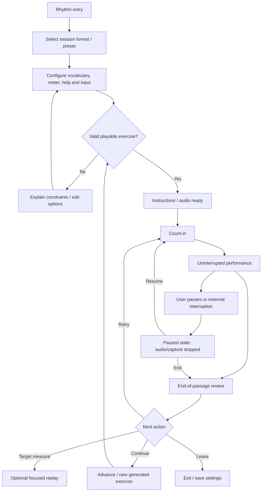

# tUno Rhythm — implementation handoff

**Status:** product requirements and architecture handoff; **not** a fully approved UI or numerical scoring specification.  
**Prepared:** 2026-10-10  
**Audience:** implementing agent with no access to prior conversation.  
**Primary feature:** **Rhythm Walk / Rhythm Game**; linked planning for **Count Writing** documented separately so shared infrastructure is not prematurely constrained.

> **Reading guide.** **[CONFIRMED]** is explicitly selected or stated by the product owner. **[PROPOSAL]** is an implementation recommendation, not an approved decision. **[OPEN]** requires product-owner resolution. **[DEFERRED]** is outside the current confirmed feature scope. **[REFERENCE]** describes a third-party resource, not a requirement to clone it. Do **not** silently convert proposals or sample figures into decisions.

## Executive summary — agreed design

Build a notation-first rhythm-reading trainer for the tUno family, conceptually called **Rhythm Walk**, with a character named Uno. It is **not** Guitar Hero: the learner must read conventional rhythm notation rather than tap to an animated arrival target. Support **tap note-onsets (default)** and **press-and-hold for full durations (optional)**; keyboard and touch input; configurable, adaptive metronome support; **three selectable session formats** (short challenges, uninterrupted longer passages, and a progressive journey); and **configurable presentation** (stationary score, optional live cursor/highlight, and independently switchable guided post-performance review). By default keep performance quiet and provide detailed review afterward. **Never stop a performance merely because a mistake occurred.** Assess **rhythm-pattern accuracy, pulse stability, and target-tempo accuracy separately** and recognize recovery: “You rushed in measure 2, but recovered.” A student's demonstrated mastery and the degree of assistance provided should both influence progression.

Content comes from an approachable **ToneSavvy-style checklist** of allowed note/rest types, dots, ties, and optional advanced restrictions on patterns/combinations. **Use two ordinary checklists, a starting configuration and optional progression goal** (the latter is an upper bound, not a guaranteed teaching sequence). Do **not** replace this interface with mandatory per-item Off/Start/Target three-state selectors. Teacher/student presets are editable and include developmental milestones plus **UIL sight-reading Levels I–VI**. UIL recommendations must **not** gate meter selection: allow a teacher to choose meters from the beginning; **changing meter mid-exercise is a separately controlled skill**.

A second activity, **Count Writing**, is an explicitly desired sibling with a common music/content model. Its detailed count-entry interaction was explored later; document its constraints to avoid architecture incompatibility, but **do not build it as an accidental part of Rhythm Walk MVP without scope approval**.

## 1. Product intent, scope, and non-goals

### [CONFIRMED] Intent
- Audience: students learning rhythmic music notation, including beginning/intermediate/advanced school band students; teacher-directed configuration and independent student practice. Product owner is a middle-school band director. Do not assume login, class roster, gradebook, assignment submission, or analytics dashboards are confirmed.
- Train musical literacy: translating **static written notation** into rhythmic attacks/durations; internal pulse, correct subdivisions, rests, sustained durations, reading through mistakes, and eventually reading across longer phrases and meter changes.
- Core principle: **“the show must go on.”** Do not require restarting/repeating a whole passage because of one error. Recognize successful continuation and recovery as meaningful musical skills.
- Configurability is essential but must not overwhelm beginning students with a giant configuration interface.
- No player-facing pseudo-notation, moving hit targets, or Guitar Hero-style reflex gameplay as the primary reading task.

### [CONFIRMED] Modes/session formats
1. **Short challenges:** discrete brief readings, scored individually.
2. **Continuous performance:** longer, uninterrupted reading with end-of-passage evaluation.
3. **Progressive journey:** Uno traverses a sequence of short tasks that can grow into longer continuous passages.
All three are configurable, not mutually exclusive roadmap alternatives; all should share the same musical/timing/content engines. Length examples discussed: **2 measures** for short tasks and **8 measures** for longer passages; these were **suggestions, not approved numeric defaults**.

### MVP scope decision
**[OPEN]** No exact feature-phased MVP line was approved. **[PROPOSAL]** Deliver a vertical slice first: setup → static engraved 1–2-measure exercise → count-in/metronome → space/touch note-onset capture → full uninterrupted pass → separate dimension scores + measure review → replay. Then add hold, guided cursor, progression and content presets. **Do not report any of these phases as already approved.**

### [DEFERRED / NOT DECIDED]
- Microphone clapping/instrument input, MIDI controller input, multiplayer, leaderboards, grading integrations, accounts, teacher dashboards, external content import/export, audio-recording of students, and a specific scenic/level narrative.
- Full Count Writing activity is a sibling workstream and needs its own design spec; overview in §12.

## 2. tUno integration and Uno's role

### [CONFIRMED] Existing tUno context
- tUno is an existing responsive music-practice application/suite with companion dog Uno and **Tune, Tone, Tempo, Tinker** views (tuner, tone generator, metronome, settings). Existing deployment context discussed previously: **tuno.cc/tune** for the tUno experience, **tuno.cc/notes** for tuNotes; site root redirects to `/tune`. These are project context, **not** approval of a rhythm URL.
- tuNotes is the note-reading game; desired consistency: customizable/adaptable content, presets, shared learning philosophy and potentially shared future progress semantics. Do not assume a shared database or implemented progression API already exists.
- The tUno visual identity uses Uno as a character and generally avoids red/orange/green as primary state semantics. Existing design language favors accessible controls, responsive layouts, theme tokens and compact controls.

### [OPEN] Placement/navigation
- No rhythm path, label, top-level navigation slot, entry card, or deep-link structure was selected. In particular **do not silently add a fifth tab** to Tune/Tone/Tempo/Tinker or assume `/rhythm` as final.
- Relationship to the existing Tempo audio scheduler and metronome controls is unspecified. Reuse shared primitives if compatible, but rhythm scoring requires a trustworthy clock independent of animation frames.
- Need to inspect current repository, routing, component library, Uno assets, theme tokens, design files, and tuNotes settings before coding. Do not infer a framework/version from this document alone.

### [CONFIRMED] Uno's pedagogical role
- Concept **Rhythm Walk**: Uno can walk/travel as students progress, giving visual game identity without visually cueing exactly when to tap.
- Support feedback such as completion and recovery; avoid punitive stop-on-error behavior.
- **[OPEN]** Exact character poses, animation style, rewards, travel mechanics, and whether walking itself tracks beat/tempo. **[PROPOSAL]** Keep all motion decorative or clearly label guided timing when it conveys temporal information.

## 3. Functional workflows and state transitions

The following is a **recommended screen/state decomposition**. States required by a finalized flow are marked confirmed where applicable, but their precise screen layouts and copy are **[PROPOSAL]** unless otherwise stated.



- **First visit [OPEN]:** choose default format, whether a quick-start preset is automatically selected, need for onboarding, audio-permission gesture, headphone recommendation, and whether device calibration is required or optional. **[PROPOSAL]** one-sentence instructions and one primary Start control, advanced settings collapsed.
- **Setup [CONFIRMED settings]:** choose gameplay format; tap-only or hold; stationary or cursor guidance; live correctness feedback off/on; post-performance review on/off; starting/goal vocabulary; meters, meter-change permission; audible metronome/assistance; tempo. Configurations may be populated by a preset.
- **Validation [REQUIRED behavior implied by content constraints]:** reject/repair configurations that cannot yield a legal complete measure or any meaningful exercise; show helpful explanation rather than hang or generate prohibited notes. The exact repair/validation UX is **[OPEN]**.
- **Instructions [PROPOSAL]:** “Read the rhythm. Tap when each note begins. Keep going if you make a mistake.” Hold-mode copy must mention release. Display input method and an optional example, not an interactive falling-note tutorial.
- **Count-in [CONFIRMED]:** audible support available; previously discussed **four-beat** example but count-in length/pickup/compound-meter behavior is **[OPEN]**. Count-in should precede capture; make first expected attack unambiguous.
- **Gameplay [CONFIRMED]:** read staff notation; tap onset via spacebar or touch; optionally hold until end; listen to metronome if on. A performance continues despite errors; no mandatory per-note retry.
- **Feedback [CONFIRMED]:** no live correctness indications by default; optional subtle noninterruptive feedback. At the end, show scores for rhythmic pattern, pulse, and target tempo; localized feedback, including recovery. Detailed review is on by default and configurable. Optional targeted replay is available, never forced.
- **Results / next [CONFIRMED concept]:** retry, continue, inspect. **[OPEN]** UI for completion, badges, unlocking notifications and review history.
- **Pause/resume [OPEN details]:** **[PROPOSAL]** on user pause or tab/device audio interruption, mute scheduled events, stop accepting taps, mark attempt interrupted, and restart at a clear count-in instead of seeking into a note mid-hold. Decide whether partial performance is discarded or retained.
- **Exit [OPEN details]:** **[PROPOSAL]** save settings and completed results, do not treat an abandoned passage as a failed reading without an explicit policy.
- **Empty/error states [PROPOSAL]:** no legal generation, muted/audio-suspended browser, unsupported input, no storage quota, visibility loss, timing calibration inconclusive, failed notation rendering. All should offer actionable retry/change settings without silent fallback that changes curriculum.

## 4. Music and interaction semantics

### Notation [CONFIRMED]
- Conventional **staff-based rhythmic notation**; notation—not moving timing targets—is the source of when notes/rests occur. Engrave note values, beams, flags, rests, dots, ties, barlines, time signatures and measure numbers legibly. Static notation can stay visible throughout a phrase; optional cursor/highlighting may follow score position. Avoid hints that turn attacks into a hit-target game.
- **Three presentation choices** exist through two independent controls: **performance guidance** = stationary or guided cursor/highlight; **post-performance guided review** = enabled or disabled. Default: stationary with guided post-review.
- Audio pulse: adaptive/configurable; begin with audible metronome, reduce or remove support as mastery grows; teacher can lock assistance. **[PROPOSAL based on discussion]** change guidance between exercises, not unexpectedly halfway through one. Assessment should retain assistance metadata.

### Input [CONFIRMED]
- **Tap-only (default):** a tap represents a **note onset**; do not tap rests; sustained notes are represented by their attack only. Taps do **not** prove proper sustain duration. The final held note cannot be duration-scored in this mode.
- **Press-and-hold (optional):** key/pad down starts note; release ends sounding/held duration and can be evaluated for release timing. Note articulations and tie behavior need precise definition before implementation.
- Keyboard **spacebar** and clickable/tappable rhythm pad. Touchscreen supported. Prevent page scroll on game-bound spacebar or touch gestures, but preserve ordinary page navigation outside gameplay.
- **[DEFERRED]** microphone, MIDI, gamepads; do not assume they ship in MVP.

### Meter [CONFIRMED]
- Select supported meter(s) from the beginning; different meters are valuable **regardless of UIL level**. With changes off, each exercise is in one meter, potentially selected among an allowed set. Allowing a **meter change during an exercise** is an independent checkbox/skill with separately configurable limits, potentially adaptive. A preset can suggest meters, **not prohibit independent override**.
- **[OPEN]** complete supported meter list, compound beat representation, beat-unit metronome options, meter-change placement, denominator changes, anacrusis/pickups.
- **[PROPOSAL]** represent musical time as rational subdivisions/ticks, not fixed integer milliseconds. For 6/8 account for compound pulse versus eighth-note subdivisions; do not treat every eighth as a quarter beat.

### Content [CONFIRMED]
- Simple checkboxes for note types: whole, half, quarter, single eighth, paired/double eighth, triplet eighth, sixteenth, dotted half, dotted quarter, quarter/half/whole/eighth rests. Allow **ties** separately. These reflect the **ToneSavvy reference**; their inclusion as a checkbox vocabulary is agreed, but exact shipped set and extensions must be confirmed.
- Optional advanced pattern restrictions for particular combinations (e.g. prevent certain syncopations even when eighths are allowed). Thus “eighth notes allowed” must **not** automatically imply every possible syncopation or combination is pedagogically allowed.
- **[OPEN]** exact handling of dotted-eighth–sixteenth, tie crossing barlines, tuplets beyond triplet eighths, sixteenth rests, syncopation taxonomy, accent scoring and supported accent markings. **No accent-specific performance rule has been agreed.**
- Rests create silence/no onset; ties should not create attacks at continuation points (**[PROPOSAL standard music interpretation]**; still test both input modes).

### Sample exercises (illustrative, NOT approved presets or difficulty defaults)
- **Round A — 4/4, one bar, tap:** half note (beats 1–2), quarter (3), two eighths (4, 4&). Expected attacks in beat units **0, 2, 3, 3.5**. The student taps four times, not once per beat. A hold-mode rendering adds note-off boundaries. This same pattern was used by the owner to explain **Count Writing** as `1 [sustained 2] 3 4 +`.
- **Round B — 4/4, rest:** quarter note on 1, quarter rest on 2, two eighths on 3 and 3&, quarter note on 4. Expected onset beat offsets **0, 2, 2.5, 3**. An extra tap during rest is a separate mistake from a missed onset.
- **Round C — recovery:** a 4-measure phrase where the player runs ahead of target in measure 2, realigns in measure 3, then finishes stably. End result should distinguish local rush from recovery, rather than declaring every later event wrong because one was early.
- **Round D — meter change:** a long phrase changes 3/4 → 4/4 when meter changes are explicitly enabled. Clear new time signature; no meter changes generated when disabled. Whether this happens with or without new count-in is **[OPEN]**.

## 5. Timing, matching, assessment, and calibration

**Confirmed principles; numeric thresholds/formulae are not yet approved.** Do not hardcode illustrative thresholds as product policy without explicit approval.

### [CONFIRMED] Assessment dimensions
1. **Rhythm-pattern accuracy:** do the relative onset durations/subdivisions form the intended pattern, including silence during rests?
2. **Pulse stability:** how consistent is the student's underlying beat? Does it rush/drag or recover?
3. **Target-tempo accuracy:** was the intended rate sustained or did performance systematically deviate?

Track measures/phrases and identify timing deviations, missing onsets, extras, and recovery. Score labels need not all be percentages until formulas are approved. Distinguish **assisted practice** from **independent performance** in stored results and progression. Don't infer a precise cause for errors from ambiguous taps.

### [PROPOSAL] Clock and event model
- Use an audio-clock timeline for the count-in, metronome and expected events, and a high-resolution monotonic input timestamp mapped to the audio timeline; do not use DOM animation frames or React render timing as the scoring clock.
- Each event: exercise ID, measure index, rational beat location, attack/no attack, duration, tie/voice/articulation metadata, expected audio onset/offset. Capture `down`/`up`, input source, monotonic timestamp, and calibration context.
- Implement a sequence alignment algorithm (dynamic programming or bounded online matching) with costs for early/late timing, missing attacks and extra attacks. **Never indiscriminately shift all subsequent errors because of a single missed tap.** Maintain both (a) alignment to prescribed absolute tempo and (b) tempo-normalized/local relational analysis. Track drift and subsequent resynchronization separately.
- Detect count-in tap events as practice/premature input separately from scored performance; choose policy explicitly.

### [OPEN] Values and formulas — decision required
- Target BPM range, inclusive bounds, tempo step and adaptation increments.
- Tolerance windows for early and late at each BPM; fixed milliseconds vs fractions of beat vs hybrid; tolerance by level.
- Pairing model and penalties for extra/missed/on-rest events; multiple input downs from key repeat; chord/polyphony (not planned for monophonic rhythm).
- Hold-release tolerance; handling legato adjacent notes, ties and release gap; whether early releases are scored differently from late releases.
- Tempo estimation estimator and window length, robust handling of sparse rhythms/long rests.
- Pulse-stability drift and recovery thresholds; thresholds for the message “rushed,” “recovered,” or “stayed steady.”
- Separate score formulas/weights, aggregate display (if any), score floors/caps, assisted-score reporting and unlock thresholds.
- Combo/streak semantics: **no combo mechanic was approved**. Prefer not to create one until its pedagogical role is decided.
- Failure criteria: **no auto-fail-on-error**; whether the learner can technically fail a completed exercise and how it affects progression are **[OPEN]**.
- Passing/mastery streak counts, data minimums, confidence thresholds, hints and assisted results.

### [REFERENCE] Latency calibration
ToneSavvy's existing exercise includes a metronome-tap device calibration (4-beat intro and eight calibration taps appear in current public page copy). This is **inspiration, not a confirmed tUno requirement**, and not permission to adopt its thresholds or block play. **[PROPOSAL]** optional calibration routine using several aligned taps, quality check for inconsistent results, per-device/input method offset, and an easy recalibrate control. **[OPEN]** need for mandatory calibration, storage lifetime, acceptable error and what happens without calibration.

### Worked test vectors (expected musical events only; no invented grading percentages)
At **80 BPM**, a quarter-note beat lasts **750 ms**. The following exercises start at `t=0` **after the count-in**; `t` is target onset time, not an acceptable window.

| Exercise | Expected attack beats | Expected attack times (ms) | Notes |
|---|---|---|---|
| A: 2-beat half + quarter + two eighths in 4/4 | 0, 2, 3, 3.5 | 0, 1500, 2250, 2625 | no extra attack on beat 2 of half note |
| B: quarter, quarter rest, two eighths, quarter | 0, 2, 2.5, 3 | 0, 1500, 1875, 2250 | tapping at 750 ms is on a rest |
| 1 quarter + 1 half in 3/4 | 0, 1 | 0, 750 | final half note should span from 750 to 2250 ms in hold mode |

**Assertion examples:** zero taps ≠ correct; two matching taps and one unexpected tap must reveal an extra input; a missed note must not force all following correct events to be misses; tap-only never claims sustain compliance; hold mode checks `up` events; after a missing note, completion remains possible; if the player is ahead in one measure then resumes alignment, feedback can identify recovery **only** when evidence supports it.

## 6. Adaptive curriculum and presets

### [CONFIRMED] Two distinct layers
1. **Difficulty adaptation** within currently allowed vocabulary: adjust elements such as tempo, rhythmic density, phrase length, rest placement and available assistance. Which variables, ranges, pace and heuristics are **[OPEN]**; these are candidate axes, not guaranteed independent controls.
2. **Optional vocabulary progression:** unlock new permitted concepts only when adequate evidence of readiness exists. Default is **bounded adaptive practice**: adaptation stays inside starting vocabulary. A separate target checklist can enable progression.

### [CONFIRMED] Vocabulary UI — FINAL revision
- Use a **ToneSavvy-like checklist with optional advanced pattern restrictions**.
- Have a **Starting** checklist and optionally a **Progression Goal** checklist (or same simple checklist in two configurations). All starting items are included in goal if goal is enabled. Goal is a **ceiling**, not a promise to introduce every item or an ordered roadmap.
- Preserve ease of use: simple presets and approachable checkboxes; advanced restrictions can be hidden until needed.
- **REJECTED EARLIER IDEA:** compulsory per-concept three-state *Off / Start / Target* segmented controls. The product owner explicitly corrected that interpretation. A demonstration later had two checkbox columns and was accepted as closer to intent; exact visual layout of those lists remains flexible.
- **[OPEN]** whether progression advances automatically, prompts student approval, or requires teacher approval. A preceding question about unlock approval was **never answered**; do not choose automatic approval simply because it was suggested.

### [CONFIRMED] Preset families
- **Developmental:** Beginning Band Midyear, Beginning Band End of Year, Non-Varsity, Varsity (names are examples given by owner; exact content is **[OPEN]**).
- **Reference-based:** Texas **UIL Band Sight-Reading Levels I–VI**, with distinct labels rather than only generic Easy/Medium/Hard.
- All presets editable; support user-defined saved presets is **[PROPOSAL]** not explicitly approved as shipped feature.
- Owner's school varsity conference is **3C**, mapping to UIL Level III, but requested preset labels should **just list UIL levels**, not force a 3C-specific variant.
- UIL is a *reference ceiling for sight-reading compositions*, not the only appropriate teaching curriculum; do not suppress other meter practice.

### UIL source-of-truth mapping [REFERENCE; verified 2026-10-10]
Official: https://www.uiltexas.org/music/concert-sight-reading/band-sight-reading-criteria (page heading: “Revised 2022”). This material states that **not every permitted element must occur**. Images on the UIL page encode exact rhythmic figures. Agent must inspect each figure rather than extrapolate from verbal shorthand, particularly Levels IV–VI.

| Level | Meters specified | Meter changes | Key rhythmic facts |
|---|---|---|---|
| I | 4/4 | none | quarter, half, dotted half, whole, paired eighths; no eighth rests; quarter rest not on beat 1; **additional percussion-only figures** |
| II | same as I | none | same rhythmic patterns as I |
| III | 2/4, 3/4, 4/4 | none (special 2023 example exception) | adds dotted-quarter–eighth pattern; specific percussion-only figures |
| IV | same as III | **one** | additional figures apply to winds and percussion, consult official rhythmic images |
| V | 2/4, 3/4, 4/4, 6/8, common time | **two** | expanded figure set including eighth–quarter–eighth, triplet and sixteenth-note figures |
| VI | same as V | **three** | same rhythmic figures as V |

**Important correction:** prior discussion inaccurately generalized some higher-level rhythms. Treat **the UIL figures themselves** as the source of truth for preset content. For Level III the official source notes a **2023 composition exception**, a 4/4→3/4 change where bands stop at the end of the last 4/4 bar; it does not change the normal Level III no-change rule.

**[PROPOSAL]** encode a frozen, versioned `criteriaSource` URL and revision in the preset metadata. A user may override UIL defaults: the source constrains a *named preset template*, not every exercise.

### Generator safeguards [REQUIRED consequences of confirmed controls]
- Use selected starting notes/rests/ties only; restrict figures per optional exclusions; reject unsupported illegal combinations; produce correct total durations per measure.
- Never let target-only concepts leak into starting exercises until unlocked.
- No meter change unless enabled, even if multiple meters are selected.
- Respect compound-meter grouping/beam conventions and tie semantics when supported.
- Ensure generation is pedagogically sensible, not merely arithmetically legal; avoid pathological all-rest/long-unreadable examples unless specifically allowed.
- **[PROPOSAL]** attach a structured `skillsUsed[]` to each generated exercise and preserve a seed to replay/debug. **[OPEN]** generated-only vs curated/authored rhythms, sequence selection and reproducibility requirements.

## 7. UI specification and annotated wireframes

**No final tUno Rhythm UI design was approved.** Earlier conversation contained *conceptual* inline illustrations of notation, a scoring summary, and a three-choice notation visualization; these are **not transferable original artwork, approved layouts or pixel specs**. The descriptions below recreate the intent independently.

### 7.1 Entry / start [PROPOSAL]
```
Rhythm Walk                            [Settings]
Read the rhythm. Play the rhythm.
[Quick Start]   [Choose a preset]   [Customize]
Session:  Short challenges | Continuous | Journey
[Start]
```
Hierarchy: accessible activity title; one clear start action; secondary customize. **[OPEN]** actual copy, route, Uno placement, whether “Rhythm Walk” is game label only or section name.

### 7.2 Configuration [CONFIRMED control semantics, proposed arrangement]
```
Session format:   Short | Continuous | Journey
Preset:           [Beginning / UIL I ... VI / ...]
Rhythms:          Starting [checkbox checklist]  Goal (optional) [checklist]
                  [Advanced pattern restrictions ▾]
Meters:           [2/4] [3/4] [4/4] [6/8] ...
                  [ ] Change meter within an exercise   [limit when enabled]
Tempo:            [BPM / assistance options]
Input:            (•) Tap onsets     ( ) Press & hold
Performance:      (•) Stationary    ( ) Guided cursor
                  [ ] Live correctness feedback (default unchecked)
                  [✓] Guided review afterward
Metronome:        adaptive / manually locked configuration
[Start]
```
The available meters/ranges displayed here are **illustrative, not approved complete enumerations**. Preset editing is allowed; do not force UIL into restrictive curriculum. Teacher vs student locking/permissions are **[OPEN]**.

### 7.3 Instructions / count-in [PROPOSAL]
- Show notation and concise instructions, controls and tempo/meter; offer a Start gesture so browsers may initialize audio.
- Count-in audible and clearly distinguishable; focus ready rhythm pad. No numerical count-in duration approved.
- Avoid mandatory calibration until confirmed.

### 7.4 Performance [CONFIRMED behavior; proposed layout]
```
Rhythm Walk                          [Pause]  Measure 2 / 8
Meter 4/4      ♩=80            [Metronome status]

   ───────── STANDARD ENGRAVED RHYTHMIC STAFF ─────────
     | measure 1 | measure 2 | measure 3 / next ... |
     (optional guided cursor; NO descending hit markers)

     [      TAP / HOLD RHYTHM PAD      ]
     Spacebar or tap

     Uno — secondary visual identity, not a timing cheat
```
- Stationary: notation must not animate attacks toward a target. Guided: optional moving cursor/highlight, track musical position, not substitute a flashing per-note timing instruction.
- Responsive: large readable staff, touch target large enough for confident tapping; mobile can display fewer bars than desktop; maintain musical continuity when page advances. Specific sizes, pan/scroll model and score pagination are **[OPEN]**.
- Audio: metronome and optional tap feedback (**[OPEN]** tap sound type/volume). No punitive error sound in quiet mode. Don't flash red/green as sole signal.
- Transitions: don't freeze music or UI to announce a wrong tap.

### 7.5 Results and review [CONFIRMED content; proposed copy/arrangement]
```
Performance complete
Rhythm accuracy   [score undecided]
Pulse stability   [score undecided]
Tempo accuracy    [score undecided]

“Your pulse sped up in measure 2, but you recovered in measure 3.”
“Try the two eighth notes in measure 2 a little slower.”

[Review measures] [Retry] [Continue] [Leave]
```
Copy above is **illustrative**, not approved verbatim. Feedback should be precise and earned by measured evidence, not canned praise or unsupported diagnosis. Provide optional measure replay. Progression messages must not conflate assisted success with independent mastery.

### 7.6 Interaction and accessibility [PROPOSAL pending audit]
- Keyboard operable: Space = tap/hold, keydown/up captured without repeat; controls reachable with Tab; Escape/pause hotkey **[OPEN]**. Avoid collisions with screen readers/forms and page scroll. Touch pad supports pointerdown/up/cancel, multi-touch policy to be specified.
- Native accessibility semantics for configuration and results; describe notated rhythms through optional accessible text/audio alternatives without automatically disclosing the solution; don't rely on color alone.
- Reduced-motion preference: Uno movement and UI transitions can stop or simplify while timing/audio and scoring remain identical; optional cursor guidance should remain legible without animation.
- Ensure high contrast, focus-visible controls, readable notation at zoom, adaptive landscape/portrait and minimum touch targets per product design system. Target devices/browsers need confirmation.

## 8. State and persistence

### [CONFIRMED] Conceptual state domains
- Session format, input style, notation guidance and review toggles, live feedback setting, tempo/metronome assistance, allowed rhythm vocabulary, optional goal, pattern exclusions, meters and meter-change controls.
- Current exercise and structured note/rest events, captured performance event stream, assisted conditions, per-dimension evaluation, feedback and recovery events, session completion and optional progression.

### [OPEN] Persistence decisions
- Which settings persist per student/device/user and whether named presets can be saved/shared.
- Whether attempt history, partial attempts, calibration and unlocks persist across reload/navigation; localStorage vs IndexedDB vs server is **not agreed**.
- Offline support is part of the broader tUno ethos discussed for other components but **was not explicitly confirmed for Rhythm Walk**. **[PROPOSAL]** core note rendering/generation/clock/scoring works client-side after app assets load; no dependency on a live service during playback.
- Reset controls and semantics, manual rollback/skill override, data deletion, teacher versus student profiles.
- **[PROPOSAL]** record schema version, content preset version, start/goal configuration, timing calibration version, assistance settings and exercise seed with each result so past scores remain interpretable.

### [PROPOSAL] Minimal state shape, not approved API
```
RhythmConfig { sessionFormat, inputMode, guideMode, reviewEnabled,
  liveFeedback, meterPool, allowMeterChanges, maxMeterChanges?,
  tempo, metronomePolicy, startingVocabulary, targetVocabulary?,
  advancedPatternRules?, presetSource? }
Exercise { id, seed?, meterEvents[], measures[], notationEvents[], skillsUsed[] }
Attempt { exerciseId, deviceCalibration?, events:[{kind, time, source}],
  interruptions[], assistance, startedAt, completedAt?, evaluation? }
Evaluation { rhythmPattern, pulseStability, targetTempo,
  measureObservations[], recoveryObservations[], confidence? }
```
Do not bind the implementation to these exact property names before auditing the existing tUno/tuNotes code.

## 9. Architecture, dependencies and performance

### [CONFIRMED] Architectural principles
- Same rhythm content/music representation for short, continuous and journey sessions.
- Starting-vs-goal bounded skill content, independent meter-change controls.
- Separate source notation, performance input, assistance, and evaluation; game visuals must not become the timing authority.
- Count Writing should eventually consume the same underlying musical events but has a different answer/evaluation model.

### [PROPOSAL] Implementation decomposition
1. **Musical domain:** rational beat positions/durations, voices (monophonic initial scope?), note/rest, dots, tuplets, ties, meters/change events, skill tagging, notation/layout metadata.
2. **Constraints + generator:** preset resolution → safe allowed vocabulary → valid measure composition → stable exercise representation; deterministic seed and property tests.
3. **Engraver:** render staff from musical domain, not hand-drawn CSS characters; responsive systems, highlights and review overlays.
4. **Audio/timing engine:** Web Audio clock/scheduler or existing tUno equivalent; lookahead scheduling; track output latency/interruption; input timestamp mapping.
5. **Evaluator:** onset pairing, local tempo analysis, pulse/tempo metrics, sustain check and measure-level explanations, with configurable scoring policy.
6. **Game state machine:** idle/setup/ready/count-in/playing/paused/review/complete/error; no timing logic in React component render loops.
7. **Adaptive curriculum and persistence:** strategy modular and bounded by start/goal and teacher overrides.
8. **Character/animations:** consume gameplay phase/summary, never inject timed instructions into stationary reading mode.

**No libraries, dependencies, browser minimums, timing precision SLA, explicit audio approach, assets list or performance target were approved.** Audit existing framework/dependencies before proposing renderer and storage. Avoid introducing network/CDN dependencies without a product decision. Test scheduling under CPU load/tab changes; seek predictable real-device results, not just synthetic unit tests.

## 10. Acceptance criteria / verification matrix

These describe **behavior**; scoring cutoffs pending approval must not be asserted as passed.

| ID | Acceptance observation | Priority |
|---|---|---|
| R01 | Setup exposes tap-only (selected by default) and press-and-hold; space and touch produce onset; hold produces distinct down/up | Critical |
| R02 | A valid 4/4 half-quarter-two-eighth exercise renders conventionally and expects attacks at 0, 2, 3, 3.5 beats | Critical |
| R03 | Tap-only never treats short physical press duration as bad sustain; hold mode captures and can evaluate release | Critical |
| R04 | Game continues through early, missed and extra notes; no automatic restart, freeze or retry prompt mid-phrase | Critical |
| R05 | Stationary display presents no moving hit-target or attack-trigger hints; guided cursor selectable independently | Critical |
| R06 | Live correctness indicators off by default, available optionally; after-review enabled by default and independently switchable | Critical |
| R07 | Separate rhythm, pulse and target-tempo outcomes; a brief rush can be localized and subsequent alignment recognized | Critical |
| R08 | One missed note does not make a subsequent accurately aligned entire phrase all wrong | Critical |
| R09 | Metronome assistance configurable/adaptive; any progression considers whether assistance was in use | High |
| R10 | All three short/continuous/journey formats exist as configurable session experiences sharing music semantics | High |
| R11 | Starting vocabulary excludes goal-only concepts until progression unlock; optional advanced pattern restrictions enforced | Critical |
| R12 | Editable UIL I–VI presets labeled by **level**, based on official figures; not an enforcement gate on student meter choices | High |
| R13 | Multiple selected meters produce single-meter exercises when changes disabled; enabled change mode may change meter within phrase | Critical |
| R14 | An impossible constraint combination never hangs, creates forbidden rhythm, or silently replaces it with unselected material | Critical |
| R15 | Exercise completion and feedback accessible on keyboard/touch and under reduced-motion; screen reader focus not trapped | High |
| R16 | Pause/external interruption never scores unattended silence as student missed taps; behavior follows approved interruption policy | Critical |
| R17 | Changes in viewport size do not change musical timing or lose scored inputs | High |
| R18 | Calibration offset (if adopted) can be measured/tested and never secretly forces fabricated scoring certainty | High |
| R19 | A completed assisted attempt and an independent attempt retain different provenance in progress records | High |
| R20 | Teacher/custom preset can allow 6/8 regardless of selected UIL level; selecting 6/8 does not implicitly turn on meter changes | High |

### Unit/property test expectations [PROPOSAL]
- Rational duration sum = required bar duration; no prohibited rhythms/tuplets/figures appear across thousands of seeded outputs.
- Expected onset offsets for §4/§5 examples; rests do not emit onset; tied continuation does not add onset.
- Boundary checks: zero taps, all taps at count-in, repeated keydown/autorepeat, held key across beat/bar, pointercancel, touch+keyboard simultaneous, clicks on other controls, very long rest, exercise ending with rest, final held note release.
- Alignment test: skip event #2 but hit events #3–#8 at expected times; downstream pairing remains stable.
- Recovery test: temporary rush then return; tag recovery without implying flawless tempo or assigning unsupported precise medical-style certainty.
- Generator: start⊆goal, goal-only excluded until unlocked; meter changes forbidden unless enabled; invalid meter/rhythm combo surfaces error.
- Consistency: audio-clock playback and notation alignment survive tab throttling tests or explicitly pause gracefully; scoring independent of display frame rate.

### Physical-device acceptance [PROPOSAL]
- Actual school Chromebook keyboard (spacebar, repeat behavior, background tab, built-in speaker/headphones).
- Touchscreen Chromebook and Android phone/tablet (tap vs hold, touchcancel, gesture conflicts, audio gesture startup, layout).
- Desktop Linux/Windows with mainstream Chromium and one other engine if practical; Bluetooth/headphone vs internal speaker timing variation.
- Simulate slow CPU, display refresh changes, sleep/resume, focus loss, and mobile audio suspension.
- Verify reduced motion, screen zoom, nonvisual navigation, no unexpectedly loud sounds, and that tap latency biases are not reported as pupil skill errors.

## 11. Suggested implementation sequence (not an approved delivery plan)

| Milestone | Deliverable / decision gate | Dependencies |
|---|---|---|
| 0. Repo audit + scope freeze | Confirm exact route, existing design/timing tools, Count Writing boundary, target browsers | Owner answers P0 questions below |
| 1. Music domain + preset schema | Rational-duration events, meters, prohibited patterns, versioned UIL source maps, test vectors | Resolve representation of compound meters/ties |
| 2. Engraver + setup | Stationary responsive notation, editable vocabulary and meter, impossible-setting handling | Existing UI/design system |
| 3. Input + audio/count-in | Keyboard and touch capture, accurate count-in, pause/focus policy, tap-only | Resolve device/audio timing approach |
| 4. Evaluator and review | Separate timing outcomes, robust realignment, localized feedback, results | Agree numerical scoring model |
| 5. Alternate modes | Hold duration, moving cursor option, optional quiet/live feedback, short/long/journey | State machine and audio engine |
| 6. Adaptive presets/progression | Starting/goal lists, bounded practice, skill unlock, assistance adjustments, presets | Resolve unlock policy/mastery values |
| 7. Accessibility / real devices / persistence | Test matrix, stable storage, interruption handling, recovery | Resolve persistence/target device contracts |

A sensible interim build agent task is **Milestone 0–2 plus an isolated playable prototype**, while requesting decisions before fixing a permanent scoring contract or navigation.

## 12. Count Writing — sibling specification boundary (important architecture constraint)

The broader product explicitly requests **two rhythm activities**. This document focuses on **Rhythm Walk**, but the later Count Writing discussion settled substantial behavior. Do not mistake these for Rhythm Walk tapping controls or omit them when designing shared music structures.

**[CONFIRMED]** Count Writing is a teacher-notation counting task, with variable counting systems and glyph placement. Current school's convention: every count for a note/rest is written beneath it; **rests use the same counts enclosed in parentheses**. Sustained beats are often raised/smaller and underlined by duration lines. For a half note beginning beat 1, enter large `1` with raised-underlined `2`; a dotted half uses `1` then raised-underlined `2 3`. For a dotted quarter on beat 1, owner prefers writing `1`, `&`, `2` with the appropriate line-affecting internal counts. Dotted eighths should *not automatically* force every sixteenth subdivision (`1 e &`) when that becomes tedious. **Default requirement:** count at every note onset and at each internal **actual beat** for sustained notes; additional subdivision positions possible, but not forced. Exact engraving of superscripts and line spans requires visual prototyping/approval.

**[CONFIRMED]** Count entry should use **fixed semantic input positions** under notation rather than drawing handwriting; each has a character slot and configurable duration-line anchor (above, side, or below). The student enters count numbers/symbols (e.g., `1`, `2`, `3`, `4`, `+`/`&`, `e`, `a`, and system-specific spoken syllables), then can drag **or tap** a line endpoint to cover slots; affected slots adopt raised/half-size/underline formatting per chosen convention. Rest toggle marks the expression in parentheses. Do not auto-fill counts. Count correctness, duration-line spans, and rest marking should be independently evaluable.

**[CONFIRMED]** Both physical keyboard and touch selection keypad. On touch focus, show selectable symbols. Two assistance settings: **open** (all valid counting alphabet symbols selectable regardless of contextual correctness) and **guided/scaffolded** (only contextually available choices). Guided mode filters **count symbols only**, NOT duration lines or parentheses. In guided mode focused slot shows filtered options, and invalid keyboard symbols are rejected. Example: 4/4 paired eighths on beat 1: first input may offer available beat numbers; after entering `1`, second eighth's menu offers only `+`/`&` according to convention; at beat 2, `1` is no longer available. Filters reset by measure and obey meter and prior choices. Track guidance condition in assessment; guided perfect ≠ independent perfect.

**[OPEN]** complete counting-system taxonomy, anchor placement policy, parentheses grouping specifics, exact sustain-line formatting/snap rules, keyboard edit/navigation, accessibility, validation of on-beat/off-beat context, hints vs answer leakage, input position reveal rules, UX sketches and Count Writing MVP scope. **[REJECTED earlier guess]** do not require freehand stylus recognition or a full equation editor.

**Architecture implication:** one shared symbolic musical event/timeline model; **different** per-activity input, scoring, and assistance policies. The Count Writing scaffolding policy must not be conflated with Rhythm Walk's visual cursor guidance.

## 13. References, mockups, provenance and transferable assets

1. **ToneSavvy Rhythm Performance** — https://tonesavvy.com/music-practice-exercise/15/rhythm-performance-game-eighth-notes/ . **[REFERENCE]** Its configurable note-type/rest checklist, time signature, tempo, hold notes, allow ties and keyboard/tap pad were useful examples. The webpage also mentions calibration. Do not copy its visual branding, source code or its stop-on-error interaction. The owner's actual screenshot is copied as `tonesavvy-reference.png` in this handoff bundle (1004×878), showing the settings page. This is **third-party reference imagery**, not a tUno asset/license grant.
2. **Official UIL Band Sight-Reading Criteria (Revised 2022)** — https://www.uiltexas.org/music/concert-sight-reading/band-sight-reading-criteria . **[REFERENCE]** Source of six level templates and allowable meter changes; **must inspect linked rhythmic figure images before encoding exact presets**. Criteria may change: record the revision, review periodically, and distinguish official source from tUno teaching recommendations.
3. **tUno existing project** — https://tuno.cc/tune . **[CONTEXT]** Existing tuner/tone/metronome product, Uno character, visual tokens and navigation. Need actual source/design system; no current screenshot supplied here.
4. **tuNotes context** — https://tuno.cc/notes . **[CONTEXT]** Note-reading sibling and source of the adaptable/customizable instructional philosophy, not evidence of a reusable technical API.
5. **Concept-only wireframes in §7** — descriptions recreated from conversation; **no pixel-accurate tUno Rhythm mockup has been accepted**. Earlier conversational inline diagrams represented stationary staff, cursor, post-performance review and sample score, but no original image files were supplied for them; use §7 plus acceptance requirements rather than pretending these are final asset references.
6. **Uno visuals/assets** — actual authorized mascot assets were not provided with this handoff. Implementing agent must locate them in tUno repo/design files; do not substitute the ToneSavvy screenshot or fabricate a new canonical mascot.

## 14. Rejected assumptions / superseded decisions

- **Do not implement a single forced game format.** The owner chose all three configurable formats.
- **Do not force always-on metronome or silence-only assessment.** Adaptive/configurable metronome is confirmed.
- **Do not force stationary-only notation.** Guided cursor is an available selectable mode; post-review is an independent setting.
- **Do not provide constant live error flashes by default.** Quiet performance and detailed review is the default.
- **Do not auto-stop or demand retries for missed/early/late notes.** Continued performance and recovery matter.
- **Do not choose only absolute-tempo or only relative-rhythm scoring.** Three separate musical dimensions are confirmed; exact math open.
- **Do not let adaptive generator introduce unselected skills automatically.** Default bounded practice; optional goal allows future concepts.
- **Do not replace a simple ToneSavvy-like starting checklist with 3-state Off/Start/Target per concept.** This was explicitly corrected. Use simple checklist + optional target checklist and pattern restrictions.
- **Do not assume a UIL level locks meters** or confound selecting multiple meters with changing meter mid-piece.
- **Do not implement teacher-defined rhythms as unrestricted random note-value combinations** that create unapproved advanced syncopations.
- **Do not implement handwriting recognition, freeform notation editor, or a Guitar Hero lane** as shortcuts.
- **Do not assume a precise score percentage, time threshold, combo mechanic, pass/fail policy, global navigation path, storage service or exact game art was selected.**

## 15. Prioritized unresolved questions — request owner sign-off

### P0: block production implementation decisions
1. **Rhythm navigation and phase boundary:** where should Rhythm Walk live in tUno and what exactly ships first (tap-only vertical slice vs all formats, hold, guided cursor, adaptive engine)? What belongs in Count Writing's separate phase?
2. **Musical-time model:** which meters and beat-unit/metronome rules are required initially, especially 6/8? Are ties across beats/bars and triplets in first release? Are exercises monophonic single-line rhythms?
3. **Timing/scoring policy:** define tolerance by BPM/difficulty, onset matching and release windows, the three score formulas/weights, alignment/recovery criteria and how much evidence a feedback sentence needs. Do not silently invent score mathematics.
4. **Progression:** exact unlock trigger, policy (automatic vs student-confirmed vs teacher), assistance-adjustment rules, and starting/goal sequencing.
5. **Preset content:** confirm the exact list of allowed rhythmic patterns and instrument-specific UIL percussion differences after inspecting official figure images; define the non-UIL developmental preset values.

### P1: user experience / reliability
6. **Count-in and calibration:** count-in length for simple/compound meters, metronome pulse/click sounds, optional vs mandatory latency calibration, allowed offset handling and output-vs-input device distinctions.
7. **Screen/layout and Uno:** preferred main activity naming, current tUno theme/nav integration, score pagination, character feedback and reduced-motion behavior; approve actual mockups/copy.
8. **Pause/interruption and failure:** pause mid-hold, focus loss, aborted attempt, retry of an incomplete performance, completion/failure reporting, whether feedback is withheld on interruption.
9. **Assist/guidance semantics:** what precisely can live cursor reveal, what counts as subtly visible live feedback, automatic de-scaffolding rules and how assisted results are reported.
10. **Persistence/device targets:** local vs account progress, per-device calibration, teacher/student presets, offline support, browser/Chromebook/tablet support and reset/delete behavior.

### P2: growth and polish
11. **Game-specific progression:** Uno journey scenes, level/round grouping, challenge length changes, replay suggestions and reward systems.
12. **Additional music semantics:** accents, articulation, swing, tuplets beyond eighth triplets, syncopation categories, tempo changes inside an exercise, pickup measures and multiple simultaneous parts.
13. **Long-term connections:** progress transfer from Rhythm Walk to Count Writing/tuNotes, assignments and reporting, microphone/MIDI support and user-authored rhythms.

**Implementation rule:** Where a choice remains P0/P1 open, build behind replaceable policy interfaces or ask for the decision. Do not treat illustrative defaults, example copy, or suggested architecture as product-owner sign-off.
